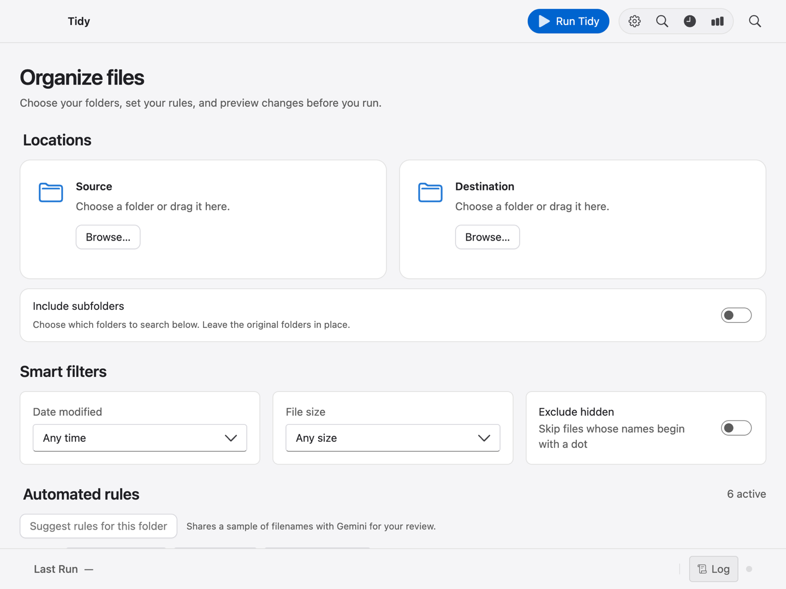
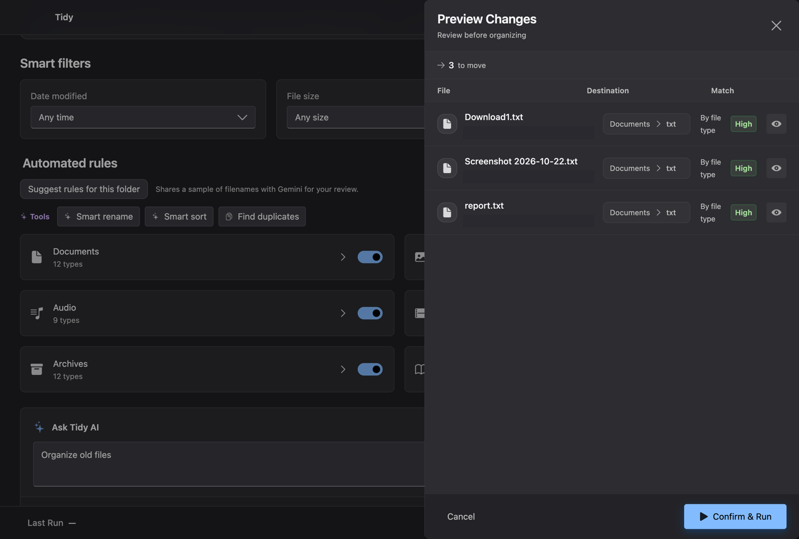
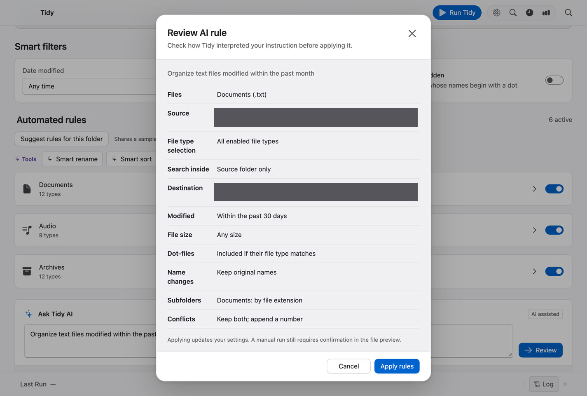

# Tidy for macOS

Tidy is a desktop file organizer for people who repeatedly sort downloads, scans, and project files. Choose the folders and rules, review the proposed destinations, then confirm the run. If the result needs to change, you can undo the latest recorded run.

**Eric Auzenne · Solo product design and development · Apple silicon**

[Read the product design case study](docs/case-study.md) · [Run Tidy locally](#get-started)



## Product design

| Design decision | How it works in Tidy |
| --- | --- |
| Make file moves easy to inspect | The preview shows the proposed destination and match reason. Quick Look lets you inspect a file before confirming. |
| Give users a way to recover | The latest recorded run can be undone. Finder Tags mode lets users organize files in place. |
| Put AI suggestions under user control | A natural-language prompt produces a rule draft. Users can review the interpreted categories, folders, and filters before applying it. Manual runs then have a separate file preview. |
| Make the privacy choice visible | Users can organize by file type, analyze supported files on-device with Apple Vision, or opt into Gemini with their own key. |

### File preview and AI rule review





The screenshots use test data. Local paths are redacted, and the AI rule review shows a simulated response.

## Get started

On an Apple silicon Mac, use Node.js 22 and the Xcode Command Line Tools. Run these commands from the repository:

```sh
npm ci
npm run dev
```

To package the app, run `npm run build:mac`. The disk image is written to `release/macos/`. For signed distribution, see [Build for distribution](#build-for-distribution). The installed app includes an offline walkthrough under **Help → Tidy Help**.

## Organize files

- Choose a source and destination, then select categories and filters.
- Turn on **Include subfolders** to choose nested folders and file types. Use a separate destination when scanning subfolders.
- **Run Tidy** previews up to 50 matching files. **Confirm & Run** processes all matches. Suggested names apply to previewed files.
- Choose **Older than…** under **Date modified** and enter a cutoff in whole days, or include it in an AI rule.
- In the preview, focus a file row and press **Space**, or click its Quick Look button. Long runs show progress on the Dock icon.
- In **Schedule and conflicts**, choose **Apply Finder tags in place** to add category tags while leaving files where they are. In move mode, you can group by download website or photo capture year and month. Files without the selected metadata use the category rules.
- **Undo Changes** reverses the latest recorded run. **Move duplicates to Trash** compares full file contents within a run when duplicate detection is enabled. Use **Put Back** in Finder’s Trash to recover trashed copies.
- Choose **Find organized files** in the toolbar and describe a file, for example “find my lease agreement.” Tidy searches names and text already indexed by Spotlight in the destination (or the source in Finder Tags mode). This search stays on your Mac.

## Automate

- Turn on **Watch for new files** to process new arrivals in the source while Tidy is running. Existing files stay in place when watching starts. Tidy waits for new files to settle and skips common partial-download extensions.
- Use the Tidy menu bar icon to reopen the window, enable **Launch at Login** in the installed app, or quit Tidy.
- The installed macOS app can run schedules while Tidy is closed and you are logged in. Allow background activity and notifications in System Settings. Use **Undo** in a scheduled-run notification or **Edit → Undo Last Organize** in Tidy. Tidy can stay in the menu bar after delivering a scheduled notification so its action remains available. Development schedules run while the app is open.

## Optional Gemini and on-device analysis

Open **Settings** with **⌘,**, enter your own key under **Gemini API key**, and choose **Save key** and **Test connection**. Tidy encrypts the key using macOS secure storage. You can remove it in Settings. Smart Rename and Smart Sort may send supported file contents to Gemini. File moves, filters, and Undo work locally.

**Suggest rules for this folder** sends a sample of up to 80 visible basenames to Gemini. Review the proposed rule set before applying it. **Smart Sort folders by year** adds a year below accepted content folders, using a recognized document date or photo capture year when available and the file’s modified year otherwise.

For local analysis, choose **On-device text recognition** under **Analyze files with**. Apple Vision reads supported images and first pages of PDFs up to 25 MB. Tidy can suggest names for generic filenames and classify common documents. This mode sends neither files nor recognized text to Gemini.

## Develop and verify

The React renderer handles configuration and review. Electron’s main process owns filesystem access, scheduling, and Gemini calls. The preload bridge exposes the supported operations, and a Swift helper provides on-device OCR through Apple Vision.

```sh
npm run typecheck
npm run build:app
npm run test:files
npm run test:subfolders
npm run test:mac-features
```

After building, run `npm run test:desktop`, `npm run test:schedule`, `npm run test:discovery`, `npm run test:subfolders:desktop`, `npm run test:source-choices`, `npm run test:key`, `npm run test:a11y`, and `npm run test:preview` to verify individual areas. Set `TIDY_EXECUTABLE` to test a packaged build. For the browser smoke test, install Chromium with `npx playwright install chromium` and run `npm test`.

Development can read `GEMINI_API_KEY` from an ignored `.env` file. A key saved in Settings takes precedence. The optional `npm run test:ai` uses synthetic inputs and a live Gemini connection.

## Build for distribution

Install a **Developer ID Application** certificate with its private key in Keychain, or provide it through electron-builder’s `CSC_LINK` and `CSC_KEY_PASSWORD`. Configure Apple notarization through `APPLE_KEYCHAIN_PROFILE`, through `APPLE_ID`, `APPLE_APP_SPECIFIC_PASSWORD` and `APPLE_TEAM_ID`, or through `APPLE_API_KEY`, `APPLE_API_KEY_ID` and `APPLE_API_ISSUER`. Keep credentials outside the repository.

Run `npm run build:mac:release` to require signing and verify the notarization ticket on the packaged app. Share the DMG from `release/macos` after the command succeeds. [Apple’s notarization guide](https://developer.apple.com/documentation/security/notarizing-macos-software-before-distribution)
