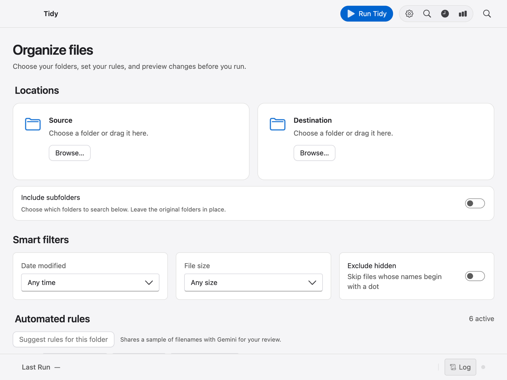
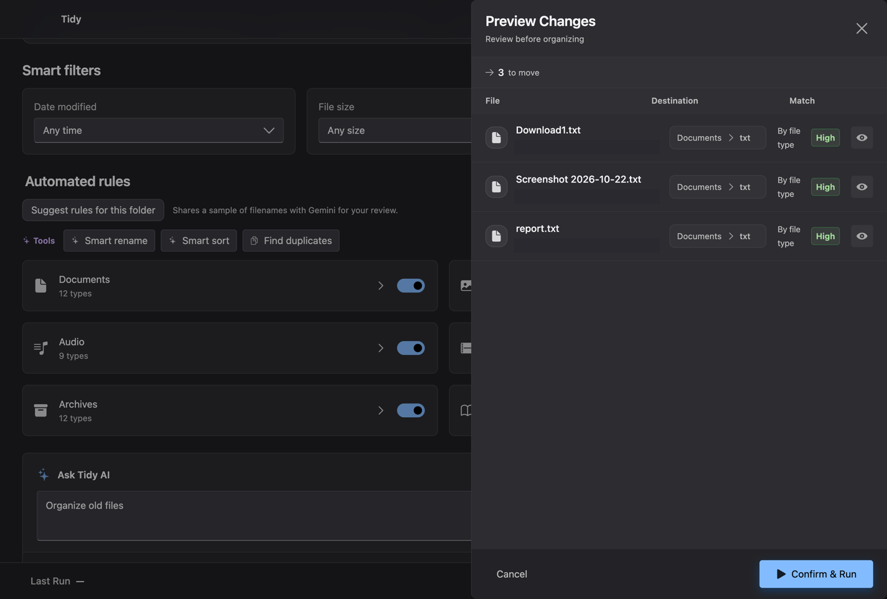
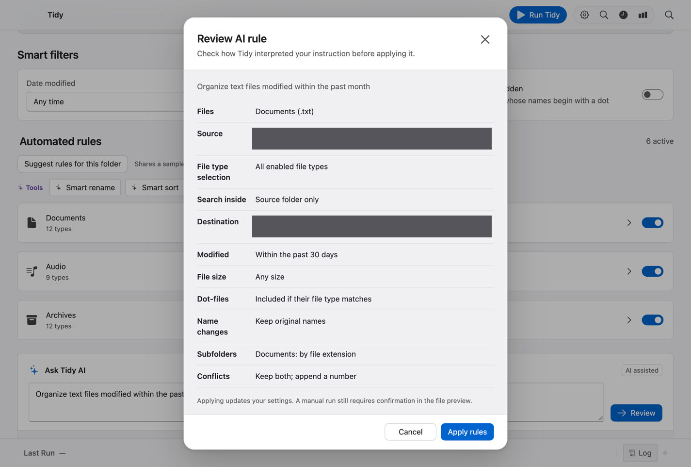

# Tidy for macOS

## Making bulk file organization safe to try

**Eric Auzenne · Solo product designer and developer**

I designed and built Tidy for people who repeatedly sort downloads, scans, and project files. A batch operation saves effort, but a single wrong folder or rule can scatter files across several destinations. I wanted people to see what would change, recognize an unexpected result, and recover from a completed run.

## Give the user control over the scope

I put source and destination first because those two choices determine where Tidy looks and where files land. Subfolder scanning is opt-in. People can narrow the scope with file types and date or size filters. Finder Tags mode supports people who want to categorize files while keeping their existing folder structure.

## Show the consequences before moving files

The manual workflow separates configuration, preview, and confirmation. The preview pairs each file with its proposed destination and match reason. Quick Look helps identify files with generic names. The preview shows up to 50 matches, while confirmation processes the full matching set. Undo covers the latest recorded run.

## Let users check how AI interpreted a request

I separated reviewing a suggested rule from confirming the resulting file moves. The first review translates a prompt into concrete settings such as file types, date ranges, and conflict handling. After applying the rule, a manual run still opens a file preview. This gives people a place to catch both a misunderstood instruction and an unexpected file match.

Gemini is optional and uses a key the user supplies. File-type rules and Undo work locally. Apple Vision gives users a separate on-device option for supported document and image analysis.

The screenshots use synthetic files and redacted paths. The AI rule review uses a simulated response.

## Verify behavior where mistakes matter

I built regression checks around file conflicts, duplicate handling, exact restoration during Undo, and the risk of two runs moving the same files. Desktop checks cover the preview, keyboard focus, rule review, and key settings. The technical setup and commands are in the [project README](../README.md#develop-and-verify).
