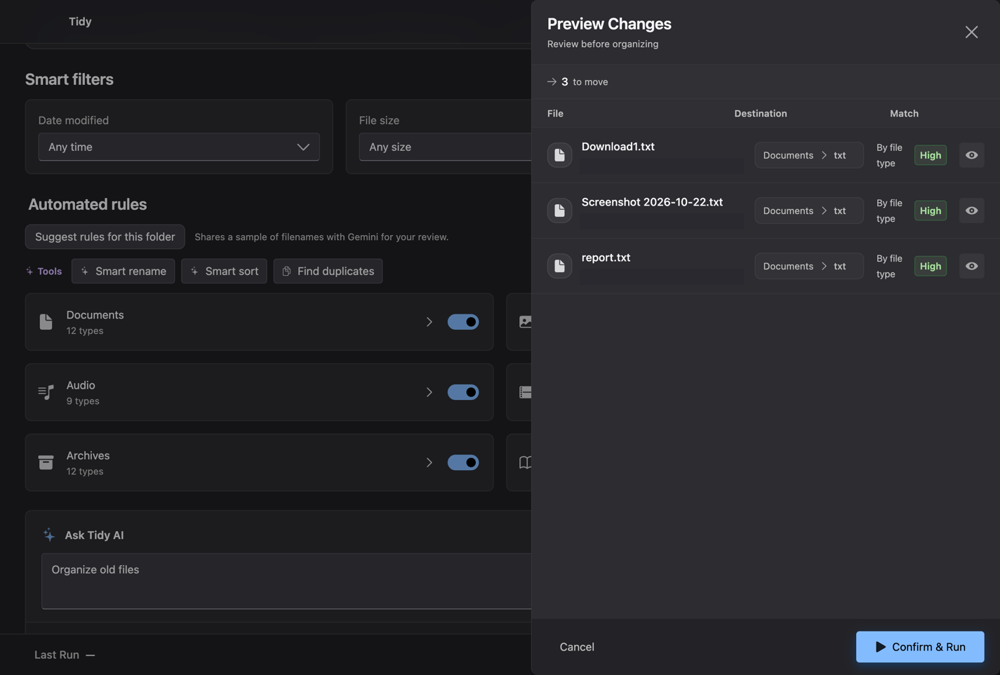
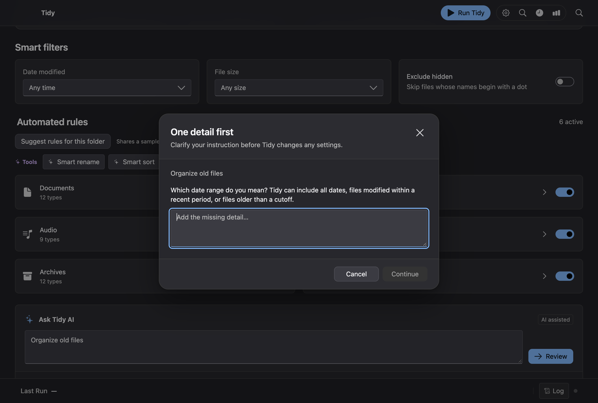

# Tidy for macOS · Design system

[Open the Figma design system](https://www.figma.com/design/F4cJIG7cCiURqp30nqszk9/Tidy-Product-Design-System?node-id=47-217) · [Read the product design case study](case-study.md)

**Eric Auzenne · Solo product design and development**

## The design problem

Tidy applies one set of rules to many files. A wrong folder, ambiguous prompt, or unexpected rename can affect an entire batch. I built the system around the decisions a user needs to make at each step. Folder cards establish where Tidy can look. Rule controls define what qualifies. The preview shows where individual files will go. Run feedback gives users a place to check what happened and undo the latest recorded run.

I carried over the Windows library’s structure from foundations and controls through workflow patterns, accessibility, and handoff. For macOS, the library uses SF Pro text styles, Light and Dark semantic variables, and reusable component families for actions, fields, folder and rule cards, preview rows, dialogs, and feedback.

## Foundations

The palette gives window, card, and control surfaces distinct roles, so the same visual hierarchy holds in both appearances. Secondary labels sit below primary content, and the accent identifies the primary action. Focus has its own token so keyboard feedback can be checked independently of action styling. Text on the primary accent is white in Light and black in Dark.

The Figma library includes a source-informed proposal. The values below document the running app where the proposal and implementation differ. The [desktop stylesheet](../src/styles/desktop.css) defines the palette, control states, and motion. The [accessibility stylesheet](../src/styles/accessibility.css) documents the implementation’s focus and accessibility treatments.

### Implemented Light and Dark palette

| Role | CSS token | Light | Dark |
| --- | --- | --- | --- |
| Window | `--background` | `#F5F5F7` | `#202024` |
| Card | `--card` | `#FFFFFF` | `#2C2C31` |
| Control fill | `--control-fill` | `#FFFFFF` | `#3B3B42` |
| Primary text | `--foreground` | `#202024` | `#F5F5F7` |
| Secondary text | `--muted-foreground` | `#5C5C5C` | `#BDBDBD` |
| Accent | `--system-blue` | `#0064CF` | `#83BBFF` |
| Text on accent | `--accent-text` | `#FFFFFF` | `#000000` |
| Focus ring | `--tidy-focus-ring` | `#0064CF` | `#83BBFF` |

## Components in use

| Pattern | Design decision | Implementation |
| --- | --- | --- |
| Folder cards and scope | Separate source from destination. Keep nested scanning opt-in and let users narrow the included folders and file types before a run. | [Locations](../src/app/components/sections/LocationsSection.tsx) · [Source choices](../src/app/components/sections/SourceChoices.tsx) |
| Rule cards and filters | Give users a visible way to enable categories and narrow the match by type, date, or size. Smart Rename exposes the naming format before the file preview. | [Category rule card](../src/app/components/sections/CategoryRuleCard.tsx) · [Filters](../src/app/components/sections/FiltersSection.tsx) |
| AI command and review dialog | Ask for a missing detail when a prompt is ambiguous. Show the interpreted settings before applying the draft. A manual run still requires a separate file preview and confirmation. | [AI command bar](../src/app/components/sections/AiCommandBar.tsx) · [AI rule review](../src/app/components/AiRuleReviewDialog.tsx) |
| Preview row | Keep the file, proposed destination, and match reason together. Use text labels alongside color to distinguish confidence states, and offer Quick Look for files whose names give little context. | [Preview sheet](../src/app/components/PreviewSheet.tsx) |
| Run feedback and recovery | Keep completion and Undo close to the run result. Undo covers the latest recorded run. | [Run status](../src/app/components/StatusBar.tsx) |

### File preview

The preview brings together the decisions made in the preceding screens. A user can check why an individual file matched and where it will land before confirming. The screenshot uses sample files and redacted paths.

### AI clarification

An instruction like “Organize old files” leaves the date range unresolved. The dialog asks for that detail before changing any settings. The screenshot uses a simulated response.

## Accessibility and handoff

The design system documents keyboard focus, dialog behavior, and motion alongside the component states. The app’s regression checks exercise keyboard focus in the preview, rule review, and file recovery. Light and Dark appearance, reduced motion, and disabled states are part of reviewing a control change. The [verification commands](../README.md#develop-and-verify) point to the relevant app checks.

When a Figma component and the running app differ, the source references above show the implementation. The [case study](case-study.md) connects these patterns to the full workflow and includes additional screenshots.
